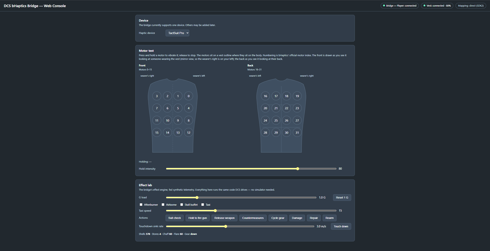

# DCS bHaptics Bridge

A Lua export script and a Python companion that drive a bHaptics
TactSuit Pro from DCS World telemetry. The script runs inside DCS and
sends flight data to the companion over UDP on localhost. The companion
converts the data into effects and sends motor commands to bHaptics
Player over a websocket.

Source only: no installer, and nothing compiled is shipped. The
default (SDK1) transport also needs no accounts and no API keys.

## This branch: the v2 (SDK2) track

This branch is the parallel v2 track. `main` carries the released
v0.3.0 (SDK1) line and is unchanged; here, the Player transport is
selectable in `config.ini`:

```
transport = sdk1   ; default - the built-in client, exactly as released
transport = sdk2   ; the official SDK2 package (this track's work)
```

What SDK2 changes, practically:

- **Setup:** needs `pip install bhaptics-python` - the project's
  only third-party dependency, isolated in
  `bhaptics_bridge/player2.py` - and, if Player enforces it,
  credentials from a haptic app registered in the bHaptics
  Developer Portal (`sdk2_app_id` / `sdk2_api_key` in `config.ini`,
  which is gitignored; the API key is a secret and is never logged).
  Whether empty credentials work is an open experiment; see
  `docs/v2-plan.md`.
- **Motors:** addressed directly (one intensity per real motor).
  The SDK1 grid translation (`pro_map.py`, the seed table,
  calibration) does not apply on this transport.
- **Web console:** gains a Vest pill with the vest's own connection
  state and battery level, which SDK1 cannot report.
- **Behaviour notes:** `play_dot` durations are floored at 100 ms
  (the vendor's recommended minimum); the package maintains the
  Player connection itself and prints its own connection log lines.
- **Status:** implemented and unit-tested (23 tests, mock backend).
  Not yet verified on real hardware - that check is milestone M4 in
  `docs/v2-plan.md`, and until it passes, v0.3.0 on `main` remains
  the verified release.

## Scope

The TactSuit Pro only. Other bHaptics devices (TactSuit Air, TactSuit
X16/X40, TactSleeve, TactVisor, TactGlove) are not supported. Support
for other devices may be added later; the motor layout and the grid
translation are isolated in `bhaptics_bridge/layout.py` and
`bhaptics_bridge/pro_map.py` for that purpose.

## How it works

```
DCS World --(Lua export script, UDP 127.0.0.1:41231)--> Python companion --(WebSocket)--> bHaptics Player --> TactSuit
```

1. The Lua script reads flight data 20 times per second (load factor,
   airspeed, sink rate, gear state, weapon station counts, warning panel
   flags) and sends it to `127.0.0.1:41231`. All traffic stays on the
   local machine.
2. The companion derives events from state changes, because the DCS export
   environment has no event callbacks: a station count dropping is a
   weapon release, a shell count dropping is gun fire, strut compression
   after airborne time with a sink rate is a touchdown.
3. The companion sends dot frames to bHaptics Player, which drives the
   suit motors.

## Requirements

- Windows 10 or later
- DCS World (Steam or standalone)
- bHaptics Player, with a TactSuit Pro connected
- Python 3.10 or later. Standard library only for the SDK1
  transport; the SDK2 transport additionally needs
  `bhaptics-python` (supports Python 3.8-3.12)

## Install

### DCS side

1. Copy `lua\DCS-bHapticsBridge-Export.lua` into:

   ```
   %USERPROFILE%\Saved Games\DCS\Scripts\
   ```

   If the Saved Games folder is named differently (for example
   `DCS.openbeta`), use that folder instead.

2. Open `Export.lua` in the same folder (create it as a plain text file if
   it does not exist) and add this line at the end:

   ```lua
   dofile(lfs.writedir() .. [[Scripts\DCS-bHapticsBridge-Export.lua]])
   ```

   The script calls any export hooks that were registered before it, so
   other export scripts (SRS, Tacview) keep working.

### Python side

No installation. Keep the folder anywhere.

## Run

1. Start bHaptics Player and connect the suit.
2. Run `run.bat`, or from a terminal:

   ```
   python -m bhaptics_bridge
   ```

3. Start DCS and enter an aircraft. On the first aircraft entry the bridge
   runs a suit check: one wave down the front of the vest, then the back.

To stop, close the console window or press `Ctrl+C`.

### Test modes

- `python -m bhaptics_bridge --test` runs the suit check once, without DCS.
- `python -m bhaptics_bridge --dry-run` prints the frames it would send,
  without connecting to Player.
- `python tools\fake_telemetry.py` sends a scripted flight profile
  (takeoff, gear cycle, G pull, weapon release, gun burst, damage,
  touchdown) to the bridge without DCS.

## Web console

`python -m bhaptics_bridge --web` also serves a web page on the local
network, at `http://<this PC's address>:41232` (port and bind address
are `web_host` / `web_port` in the config). It has three parts:

- **Status.** Whether the bridge is connected to bHaptics Player. The
  protocol cannot report whether the vest itself is powered and
  paired; that is shown in Player's own window.
- **Motor test.** The TactSuit Pro drawn front and back as a vest
  outline, motors positioned where they sit on the body and numbered
  with the official motor index (front in mirror view, as in the
  bHaptics diagram; the wearer's left and right are labelled).
  Pressing and holding a motor vibrates it until released, through
  the same Pro-to-grid translation the effects use (seed table, or
  `pro_mapping.json` when present).
- **Effect lab.** The effect engine fed with synthetic telemetry, so
  every effect — G load, afterburner, stall, gear, touchdown, weapon
  release, gun, countermeasures, damage, taxi — can be tested without
  starting DCS.



There is no authentication: anyone on the LAN who opens the page can
drive the suit. Trusted networks only.

## Effects

| Effect | Trigger | Motors |
|---|---|---|
| Suit check | First aircraft entry | Front rows top to bottom, then back rows |
| Positive G | Load factor at or above `g_onset` (default 2.0) | Front and back; lower rows first, higher rows added as load increases |
| Negative G | Load factor at or below 0.2 | Chest and shoulders, front and back |
| Afterburner | Afterburner lit (draw arguments 28/29) | Lower back rows |
| Stall buffet | Angle of attack at or above threshold (default 0.30 rad), airborne | All motors, random low intensity |
| Gear transit | Gear position between up and down | Lower rows, alternating front and back |
| Gear locked | Gear reaches fully up or down after a transit | Lower rows, front and back, one thump |
| Touchdown | Strut compression after at least 0.5 s airborne, with sink rate | All motors; intensity scales with sink rate |
| Weapon release | Total station count drops | Mid rows, front and back |
| Gun | Cannon shell count drops | Chest centre, front |
| Countermeasures | Chaff or flare count drops | Shoulder row, front and back |
| Damage | New failure flag on the warning panel | All back motors, three pulses |
| Taxi bumps | Vertical load deviation while rolling on the ground | Lower rows, front and back |

## Configuration

Copy `config.example.ini` to `config.ini` and edit. All settings are
optional. Available settings: master intensity scale, per-effect switches,
stall AoA threshold, G onset and full-scale values, and UDP and Player
ports.

## Notes

- Player protocol: bHaptics' SDK1 websocket interface,
  `ws://127.0.0.1:15881/v2/feedbacks`. JSON field names use PascalCase,
  matching observed SDK1 client traffic. Confirmed working against
  bHaptics Player on 2026-11-16.
- Motor layout: the TactSuit Pro has 32 motors, 16 per side in a 4x4
  grid. Effects are defined directly on those motors, numbered as in
  bHaptics' Motor Index page: front 0-15, back 16-31, row-major from
  the top-left of each side.
- Grid translation: frames are submitted over the SDK1 protocol, whose
  vest grid has 20 points per side. The bridge translates Pro motors to
  grid points (`bhaptics_bridge/pro_map.py`). How Player maps the grid
  onto the Pro is not published, so the built-in table is an assumption
  and is marked as a seed in the code. Run
  `python tools\calibrate_pro.py` once to measure the mapping on your
  own suit; it writes `pro_mapping.json`, which the bridge then loads
  automatically.
- DCS provides no export signal for ejection. There is no ejection effect.
- Multiplayer: the export script is installed in Saved Games and does not
  modify DCS install files. Servers can restrict which export data is
  available, and servers running pure scripts may reject clients with
  script mods.

## Uninstall

Delete the added line from `Export.lua`, delete the Lua file, and delete
this folder. No other files are modified.

## Development

```
lua\              the DCS export script
bhaptics_bridge\  the companion (telemetry, effects, Player client)
tools\            fake_telemetry.py (scripted flight), mock_player.py (fake Player server), calibrate_pro.py (measure the grid-to-Pro mapping)
tests\            python -m unittest discover tests
```

MIT license. See `LICENSE`.
